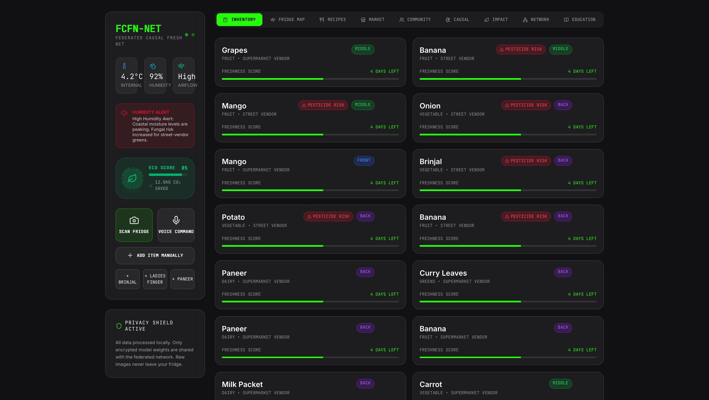
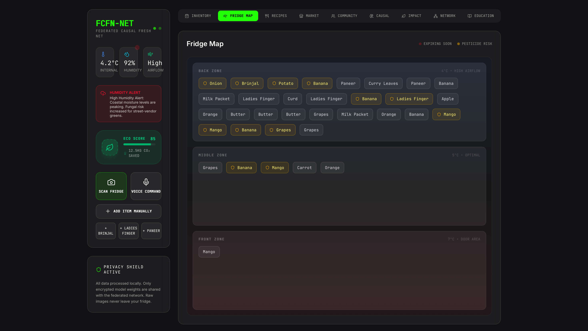
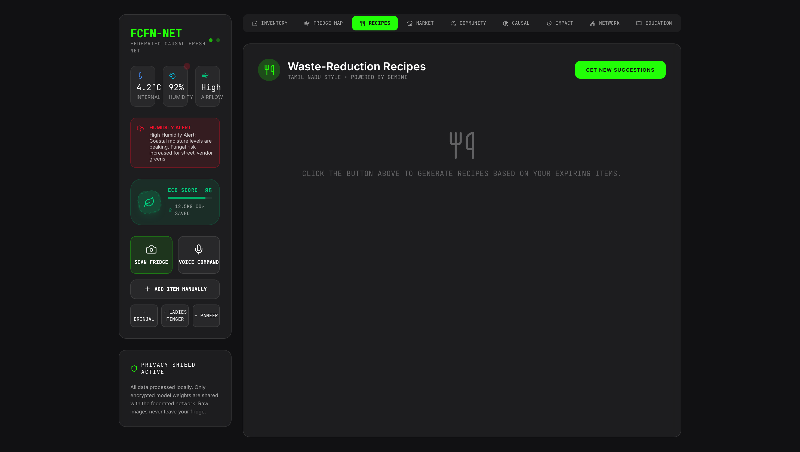
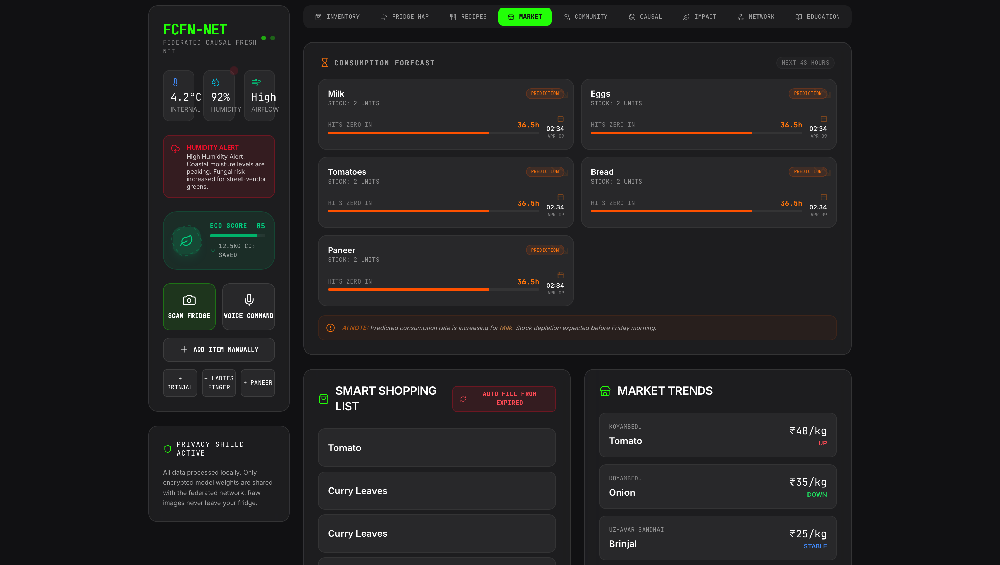
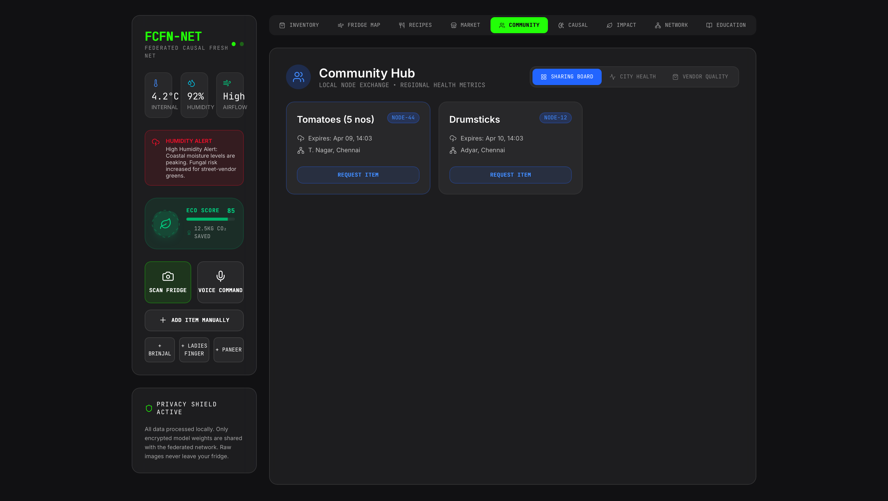

# FedCausalFreshNet (FCFN)

**Federated Causal Fresh Net** is a next-generation "Smart Fridge" ecosystem designed to combat food waste using Privacy-First Federated Learning and Causal Intelligence. Specifically optimized for the high-humidity coastal environment of Tamil Nadu, FCFN bridges the gap between local street vendors and modern kitchen management.

---

## 🛠️ Core System Walkthrough (First 5 Modules)

### 1. Unified Inventory Intelligence

*Filename: `inventory_dashboard.png`*

The Inventory view provides a real-time health check of your fridge contents. 
- **Vendor-Aware Tracking**: Distinguishes between "Street Vendor" and "Supermarket" produce to adjust base spoilage rates.
- **Pesticide & Spoilage Alerts**: High-risk items (like street-vendor Mangoes or Brinjals) are flagged based on city-wide health trends.
- **Freshness Score**: A visual progress bar depicting the estimated shelf-life "lift" gained via optimal placement.

### 2. Physical Fridge Optimization (Spatial Mapping)

*Filename: `fridge_map.png`*

FCFN's "Fridge Map" isn't just a layout—it's a treatment recommendation engine.
- **Zone Heatmaps**: Visualizes items in the **Back** (High Airflow), **Middle** (Optimal), and **Front** (Door Area) zones.
- **Expiring Soon Alerts**: Items nearing their predicted end-of-life status are highlighted in red.
- **Placement Guidance**: Suggests moving items to specific zones to maximize "shelf-life lift" based on causal models.

### 3. AI-Driven Waste Reduction (Gemini Powered)

*Filename: `recipes_ai.png`*

We use Large Language Models (Gemini API) to turn near-expired items into "Tamil Nadu Style" recipes. 
- **Zero-Waste Logic**: Prioritizes items that have the lowest freshness scores.
- **Contextual Suggestions**: Focuses on local cuisine patterns to ensure ingredients are used effectively before they spoil.

### 4. Consumption Forecasting & Market Trends

*Filename: `market_forecast.png`*

Stay ahead of your kitchen's needs with predictive analytics.
- **Consumption Forecast**: Predicts exactly when staples (Milk, Paneer, Tomatoes) will hit zero units.
- **Local Market Prices**: Real-time price tracking from Chennai's major hubs like **Koyambedu** and **Uzhavar Sandhai**.
- **Smart Shopping List**: Automatically populates based on detected depletion trends and expired item removals.

### 5. Community Hub: Federated Food Exchange

*Filename: `community_hub.png`*

The Community Hub proves that "Privacy-First" doesn't mean isolated.
- **P2P Node Exchange**: Users can share surplus items (e.g., Node-44 in T. Nagar sharing Tomatoes) with neighbors.
- **Regional Health Metrics**: Aggregates anonymized freshness data from the Federated Network to detect city-wide quality shifts.
- **Vendor Quality Score**: A reputation system for local markets based on aggregated "Direct Vendor Quality" reports from all nodes.

---

## 🏗️ Technical Architecture

- **Federated Learning (Flower)**: Trains global spoilage models on 5+ local fridge nodes without ever seeing raw camera data.
- **Causal Intelligence (DoWhy)**: Calculates the *Direct Effect* of fridge zones on freshness, confounding for external humidity.
- **Vision Core (YOLOv8)**: Real-time item detection and spatial tracking.
- **Voice Assistant**: A context-aware aide for hands-free kitchen management.

---

> [!IMPORTANT]
> **Next Steps**: After uploading these 5 images to the `/assets/images` directory, please send the remaining 5 pictures to complete the "Causal Intelligence" and "Eco-Impact" sections of the documentation.
